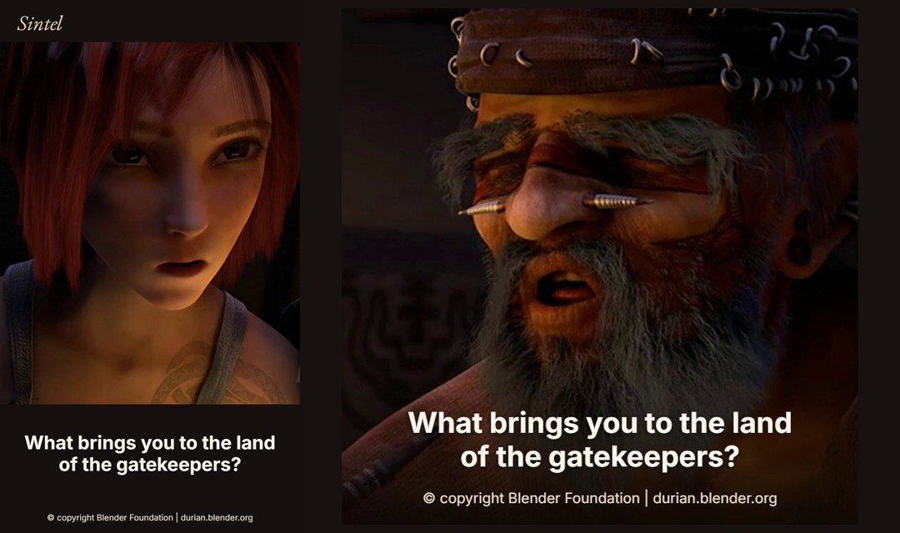

# Sintel · a two-line dialogue edit

[Watch the vertical edit](https://raw.githubusercontent.com/oppo2357/sintel-dialogue-clip-sample/main/portrait.mp4) · [Watch the square edit](https://raw.githubusercontent.com/oppo2357/sintel-dialogue-clip-sample/main/square.mp4)

The gatekeeper asks what brought Sintel to his land. The camera holds on her face before her reply carries into the next setting. I chose the exchange because it gives a viewer the protagonist’s motive in two complete sentences. The W3C source is a video file with no audience-retention data, so this selection used the dialogue, scene changes and shot composition.

[](https://raw.githubusercontent.com/oppo2357/sintel-dialogue-clip-sample/main/portrait.mp4)

| Source at 24 fps | Edit decision |
| --- | --- |
| Frames 279–333 | Open just before the gatekeeper speaks. Keep his face in frame. |
| Frames 334–368 | Move the crop to Sintel when the original cuts to her reaction. The question finishes over this shot. |
| Frames 435–506 | Shorten the dark pause and carry “I’m searching for someone” over the village. Finish after the last word. |

Both exports retain the source sound and run 6.75 seconds. The portrait uses a taller picture area and a separate caption area. The square places its captions over the shaded lower edge. The two edits use the same source frames and the same caption cues.

The first machine transcription heard “some love.” The [independently published English captions](https://github.com/chrisdavidmills/html5-captions-and-subtitles-content-kit/blob/gh-pages/demo/step4/vtt/sintel-captions-en.vtt) confirm “someone.” That caption file uses a different time base, so I timed the subtitles against the actual [52-second source trailer](https://media.w3.org/2010/05/sintel/trailer.mp4).

## Reproduce the edit

Use Python 3, FFmpeg on PATH, and Node.js with npm. The build script fetches the source, cuts the original audio and picture, and writes a HyperFrames composition for each aspect ratio.

```sh
python build_sample.py
npx --yes hyperframes@0.9.65 render portrait --quality delivery --fps 24 --workers 1 --output portrait.mp4
npx --yes hyperframes@0.9.65 render square --quality delivery --fps 24 --workers 1 --output square.mp4
```

The source used for these exports has SHA-256 `b670602fa00934ca27c4351bb0efe7ea7a07fae57284e44226025eeed7c51254`.

## Film credit

© copyright Blender Foundation | durian.blender.org. *Sintel* is licensed under [Creative Commons Attribution 3.0](https://creativecommons.org/licenses/by/3.0/). This sample excerpts, reframes and captions trailer footage. The film, dialogue, performances and soundtrack belong to their credited creators. [Blender Foundation’s sharing terms](https://durian.blender.org/sharing/)
